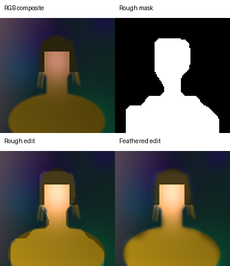
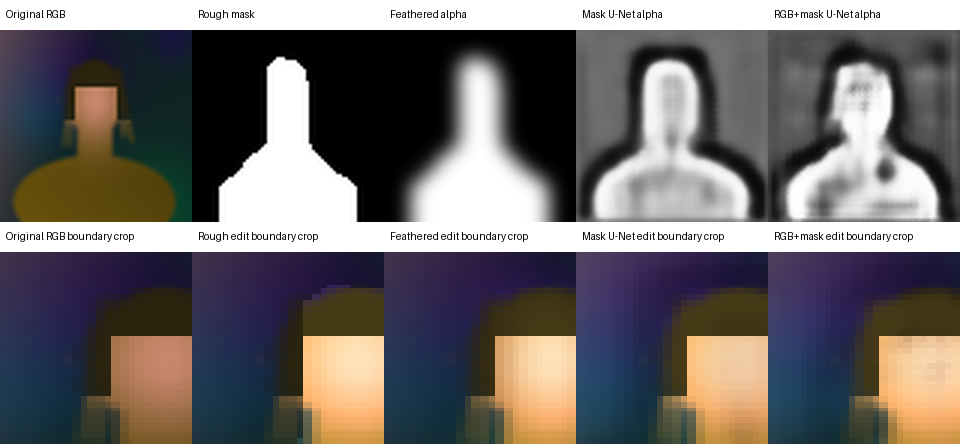

# Portrait Mask Refinement

A compact, reproducible PyTorch experiment for an Aftershoot ML internship portfolio: can a small CNN recover portrait boundaries better when it sees the RGB image as well as a rough mask?

A rough portrait mask may clip fine hair or leak into the background. This project composites foregrounds using ground-truth alpha mattes, deliberately damages their masks, and compares four refiners on the exact same held-out identities: the rough binary mask, validation-tuned Gaussian feathering, a mask-only U-Net, and an RGB-plus-mask U-Net. Both CNNs share the same examples and settings. The primary selection metric is alpha MAE inside a fixed-width band derived only from the ground-truth boundary.



> This image and all reported numbers below are from a procedural smoke-test fixture, not real portraits.

## Results

Procedural smoke test: 36 generated identities, three deterministic perturbation strengths per identity, 64×64 resolution, six epochs, base width 8, and a 3 px ground-truth boundary band. The identity split produced 29 train, 2 validation, and 5 test identities (15 test composites). Gaussian radius 3.0 px was selected on validation only.

| Method | Full-image alpha MAE ↓ | Boundary alpha MAE ↓ |
|---|---:|---:|
| Rough mask | **0.1830** | 0.3901 |
| Gaussian feather | 0.1838 | 0.3629 |
| Mask-only U-Net | 0.2766 | 0.1656 |
| RGB + mask U-Net | 0.2271 | **0.1111** |

On this smoke fixture, RGB access reduced boundary MAE by 32.9% versus the mask-only U-Net, answering the experimental question in the affirmative for the fixture. It did not win full-image MAE: the rough mask baseline did. The learned models were optimized toward boundary quality, and the short run left interior calibration under-trained. These are plumbing-scale results, not evidence about real portrait performance. A real-data experiment remains **pending**.



## Quick start

Python 3.10+ is required. PyTorch automatically uses CUDA on Colab, MPS on Apple Silicon, or CPU when `--device auto` is selected.

```bash
python3 -m venv .venv
source .venv/bin/activate
pip install -e '.[dev]'

# Start with one RGB fixture, one rough mask, and rough-vs-feathered edits.
pmr fixture-preview --output-dir outputs/preview

# Validate inputs and materialize the identity-first split manifest.
pmr prepare --output outputs/data/splits.json

# Full default experiment at 256x256.
pmr train --input-mode both --resolution 256 --output-dir outputs/train
pmr evaluate \
  --mask-checkpoint outputs/train/best-mask.pt \
  --rgb-checkpoint outputs/train/best-rgb-mask.pt \
  --resolution 256 --output-dir outputs/eval

# Inference needs only an RGB image, rough mask, and trained checkpoint.
pmr infer \
  --checkpoint outputs/train/best-rgb-mask.pt \
  --image photo.jpg --mask rough-mask.png \
  --alpha-output outputs/inference/refined-alpha.png \
  --comparison-output outputs/inference/comparison.png
```

For real licensed data, use RGBA PNG cutouts and a background folder:

```bash
pmr prepare --portraits-dir /path/to/rgba_portraits --backgrounds-dir /path/to/backgrounds --output outputs/data/real-splits.json
pmr train --input-mode both --portraits-dir /path/to/rgba_portraits --backgrounds-dir /path/to/backgrounds
```

See [DATA.md](DATA.md) for the expected layout, provenance checklist, and usage-term guidance. Paths, seed, resolution, batch size, model width, boundary width, and optimizer settings are CLI-configurable. Samples are made on demand, keeping development memory bounded.

## Method

- Split original portrait identities 70/15/15 before any compositing or augmentation. A stable SHA-256 bucket keeps all versions of a subject together.
- Composite the RGB foreground over a background with ground-truth alpha.
- Produce three roughness levels by down/up-sampling, erosion or dilation, and occasional small holes. Validation and test generation use a fixed seed.
- Train a small three-level U-Net to regress alpha in `[0, 1]`. The loss combines full-image MAE with extra weight on a fixed-width ground-truth boundary band.
- Select each model's checkpoint by validation boundary MAE. Tune Gaussian radius only on validation data, then freeze it for test evaluation.
- Export per-image metrics, a four-way summary, alpha visualization, and equal-strength subject-only exposure edits.

## Outputs

Training writes best checkpoints and JSON histories. Evaluation writes `summary.json`, `per-image.csv`, and `four-way-visual.png`. Generated data, caches, outputs, checkpoints, secrets, and virtual environments are ignored by Git.

## Limitations and failure cases

- The procedural fixture validates the experiment, not real-world quality. Its hair and background statistics are simplistic.
- Small 256×256 inputs can erase very fine strands before the network sees them.
- Synthetic erosion, dilation, scale loss, and holes may not match errors from production segmenters.
- Strong color similarity between subject and background can make RGB evidence ambiguous.
- Unusual poses, translucent fabric, motion blur, flyaway hair, and out-of-distribution lighting need representative real training data.
- A refined matte cannot reconstruct detail absent from both the RGB input and rough mask. The baseline is allowed to win and is always reported.

## Verification

Run:

```bash
pytest -q
python -m compileall -q portrait_mask_refinement
```

The exact smoke-test commands used for the table were:

```bash
pmr train --input-mode both --resolution 64 --fixture-identities 36 --samples-per-identity 3 --epochs 6 --batch-size 8 --base-channels 8 --boundary-width 3 --device mps --output-dir outputs/smoke/train
pmr evaluate --mask-checkpoint outputs/smoke/train/best-mask.pt --rgb-checkpoint outputs/smoke/train/best-rgb-mask.pt --resolution 64 --fixture-identities 36 --samples-per-identity 3 --boundary-width 3 --device mps --output-dir outputs/smoke/eval
```

The repository is MIT-licensed. Third-party datasets retain their own terms.
