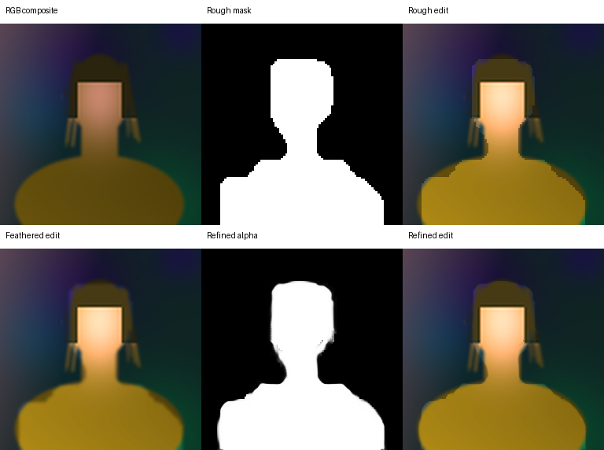
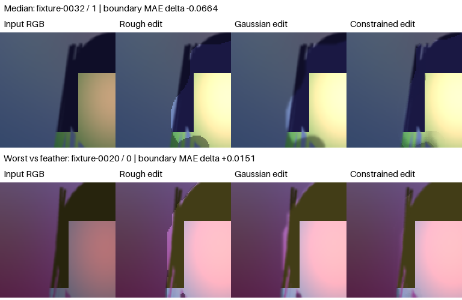
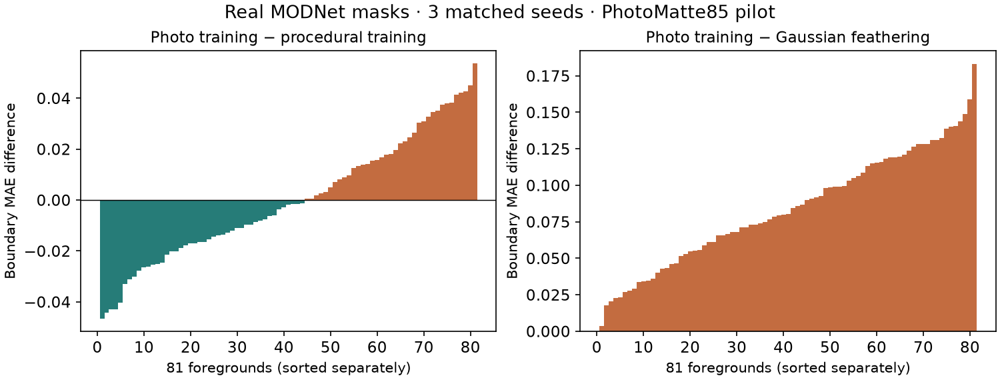
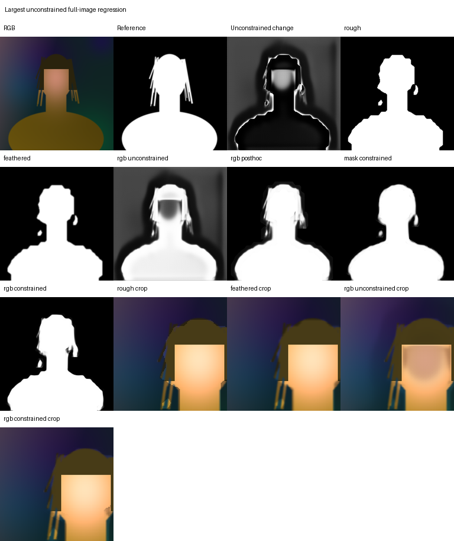

# Portrait Mask Refinement

Boundary-constrained alpha-matte refinement for portrait editing. Given an RGB portrait and a rough foreground mask, a compact U-Net predicts hair and shoulder corrections while a hard constraint copies the supplied mask **exactly** everywhere outside an erosion–dilation band.

The repository includes a runnable inference CLI, deterministic training pipelines, frozen evaluation splits, per-image measurements, and controlled comparisons with raw masks and Gaussian feathering. Its emphasis is reproducible model behavior rather than a showcase-only result.



Procedural fixture (not a photograph): RGB input and supplied rough mask; rough-mask, Gaussian-feathered, and constrained RGB U-Net exposure edits, all at +0.75 stops. The CNN checkpoint was trained only on procedural images.



Identical 96×96 hair/shoulder crops enlarged 2×: input, rough-mask edit, Gaussian feathering, and constrained RGB U-Net. Top: median fixture condition; bottom: largest constrained-CNN boundary regression versus feathering. Both use +0.75 stops; this is a procedural illustration, not photographic evidence.

## Photographic-training study

**Switching to photographic foregrounds alone did not reliably help on real MODNet masks, and it did not beat feathering.** Using MODNet masks during photographic training helped the one-seed mask-matched variant substantially, but feathering still won.

PhotoMatte85 supplied **65 training / 20 validation foreground images**, composited over shared procedural backgrounds. The matched arms used the same constrained U-Net, 256×256 resolution, loss, band, six epochs / **294 updates**, and seeds **17, 23, 41**. Both selected checkpoints on the same photographic validation set. This isolates the foreground-data change; it is not a large-data or natural-background training claim.

Main evaluation: **81 frozen PPM-100 test foregrounds ×1 binary MODNet mask**, at 256×256. The separate 19-image PPM validation split selected Gaussian radius 0.5. Lower is better:

| Method | Full MAE | Boundary MAE | Correct FG damaged | Correct BG damaged |
|---|---:|---:|---:|---:|
| Raw MODNet (binary) | 0.01063 | 0.03535 | 0.00% | 0.00% |
| Gaussian feather | **0.00960** | **0.03152** | 0.09% | 0.03% |
| Existing procedural checkpoint | 0.02872 | 0.10307 | 0.43% | 0.13% |
| Matched procedural training, 3-seed mean | 0.03191 | 0.11582 | 0.37% | 0.12% |
| Photographic + controlled masks, 3-seed mean | 0.03155 | 0.11580 | 0.44% | 0.11% |
| Photographic + MODNet masks, seed 17 only | 0.01284 | 0.04592 | 0.28% | 0.10% |

Photographic minus procedural boundary MAE: **−0.000017**, foreground-bootstrap 95% CI **[−0.00527, +0.00507]**; 44/81 foregrounds improved, without a reliable average benefit. Photographic minus feathering: **+0.08429**, CI **[+0.07572, +0.09263]**; 0/81 improved. Matching MODNet errors reduced seed-17 photographic boundary MAE from 0.12406 to 0.04592, but remained worse than feathering by +0.01440 (CI [+0.00916, +0.02007]). This optional result has **one seed**, not three.



Each bar is one test foreground; negative means better. The CNN trained on controlled erosions/dilations over-corrects already-strong MODNet boundaries. The constraint prevents edits outside the band, not damage inside it. The mask-matched result supports error-distribution mismatch as an important limitation in this pilot. Studio portraits, synthetic backgrounds, a small training set, and unverified subject identities limit generalization.

See the [complete photographic study and commands](docs/PHOTOGRAPHIC_STUDY.md), [frozen manifests, paired results, and run histories](reports/photographic-study/), and [source-overlap audit](reports/photographic-study/data-audit.json). No PPM image trained a CNN; no source duplicates were found by the documented checks, but person-disjointness is unproven. Portrait images, local improvement/failure crops, datasets, and third-party/new model weights are not committed.

**Secondary evaluation, controlled corruptions:** on the same 81 foregrounds ×3 corruptions (**243 conditions**), photographic training improved boundary MAE from **0.14203 to 0.13378** (three-seed means; paired difference −0.00825, 95% CI [−0.01309, −0.00353]). Feathering scored 0.13680: the photographic CNN had a lower point estimate, but its difference versus feathering, −0.00302 [−0.01020, +0.00396], was inconclusive. Thus photographic training helped under controlled corruption, but not reliably on the main real-MODNet-mask condition. Across-seed SDs and all secondary metrics are in the complete study.

## Controlled-corruption benchmark

The constraint solves the original safety failure, but it does **not** beat the simplest baseline on the main photographic benchmark. On 81 held-out PPM-100 foregrounds × 3 controlled corruptions (243 conditions, 256×256), the best seed reduced damage to already-correct foreground/background pixels from **81.1% / 99.99%** for the unconstrained CNN to **1.48% / 0.08%**. Its boundary MAE was 0.1392; validation-tuned Gaussian feathering won at 0.1368.

| Method | Full MAE ↓ | Boundary MAE ↓ | Correct FG damaged ↓ | Correct BG damaged ↓ |
|---|---:|---:|---:|---:|
| Rough mask | 0.0375 | 0.1383 | **0.00%** | **0.00%** |
| Gaussian feather | **0.0371** | **0.1368** | 0.57% | 0.02% |
| RGB U-Net, unconstrained | 0.2733 | 0.2496 | 81.07% | 99.99% |
| Original RGB U-Net + post-hoc constraint | 0.0392 | 0.1443 | 1.24% | 0.08% |
| Mask-only U-Net, constrained | 0.0388 | 0.1481 | 0.45% | 0.07% |
| RGB + mask U-Net, constrained | 0.0386 | 0.1392 | 1.48% | 0.08% |

Across seeds 17, 23, and 41, constrained RGB boundary MAE was **0.1431 ± 0.0034** (sample standard deviation). The evidence supports the constraint as an inference safety property, not as a guaranteed accuracy improvement.

## Boundary-constrained inference

An unconstrained refiner emits an alpha value for every pixel. In the initial experiment it achieved strong synthetic boundary MAE but changed 99.9% of already-correct interior pixels. The constrained inference path computes an editable band from the rough mask alone:

```text
editable = dilate(rough) - erode(rough)
output   = editable * cnn_alpha + (1 - editable) * rough
```

The ground-truth boundary used for evaluation remains separate from this inference-time band. Regression tests verify that output dimensions match the input and every pixel outside the editable band remains unchanged.

## Benchmarks

### Photographic controlled-corruption protocol

- Dataset: PPM-100, downloaded from the [official repository](https://github.com/ZHKKKe/PPM).
- Contents: 100 natural photographic portraits with alpha mattes; subject identity metadata is unavailable.
- Frozen filename-hash split: 19 validation foregrounds and 81 test foregrounds.
- Test conditions: three deterministic corruptions per test foreground, 243 total.
- The models in this historical table train only on the procedural fixture; PPM validation selects feather radius and editable width.
- Evaluation band: 12 px around the ground-truth contour. Editable band: 4 px around the supplied rough mask.
- Uncertainty: 95% bootstrap intervals aggregate repeated conditions at foreground level; per-condition measurements and paired differences are exported to CSV.

### Practical pretrained-mask condition

The official MODNet photographic checkpoint was thresholded to produce one rough mask for each PPM image. In this **64×64 pilot** (3 px evaluation band, 2 px trained editable band), on 81 test images, the MODNet rough masks scored 0.0606 boundary MAE and Gaussian feathering improved this to **0.0496**. Every CNN variant made these already-strong masks worse. This condition is reported separately from the 256×256 controlled corruptions; the numbers are not directly comparable across resolutions. **Gaussian feathering won both historical photographic benchmark conditions.** All CNNs in these historical tables trained on procedural data; PPM-100 supplied photographic evaluation images only. The photographic-training study above reports learned models trained with photographic foregrounds separately.

### Latency

End-to-end timing includes image decode, preprocessing, the network, constraint, and output resize. It excludes model loading and disk write. After 10 warmups, 50 runs at 256×256 on this Apple Silicon machine measured:

| Device | p50 | p95 |
|---|---:|---:|
| Apple MPS | 20.0 ms | 25.7 ms |
| Apple CPU | 95.0 ms | 96.0 ms |
| CUDA | Pending—CUDA was unavailable | Pending |

## Quick demo

The committed 492 KB checkpoint was trained only on this repository's MIT-licensed procedural fixture; no third-party portraits or weights are embedded in it.

```bash
python3 -m venv .venv
source .venv/bin/activate
pip install -e '.[dev]'

pmr infer \
  --checkpoint demo/checkpoints/portrait-refiner-fixture-256.pt \
  --image demo/sample/portrait.png \
  --mask demo/sample/rough-mask.png \
  --alpha-output outputs/demo/refined-alpha.png \
  --comparison-output outputs/demo/comparison.png
```

Checkpoint SHA-256: `eadf2513e5e72228a86e4f4a3ce63b1d2f84bf2cd2733ed73e6488feb09de4ff`.

## Reproduce the data and experiments

PPM-100 requires no approval form. Its photographs retain their Flickr Creative Commons terms; its alpha mattes are CC BY-NC-SA 4.0. Data remains ignored and is not redistributed here.

```bash
pip install gdown
mkdir -p data/ppm100
gdown 'https://drive.google.com/uc?id=1JUx-EPoV9QAhQgmW0AyOen-xKQUzZia-' -O data/ppm100/PPM-100.zip
unzip data/ppm100/PPM-100.zip -d data/ppm100/extracted

# Reproduce the original fixture experiment.
pmr train --input-mode both --resolution 64 --fixture-identities 36 \
  --samples-per-identity 3 --epochs 6 --batch-size 8 --base-channels 8 \
  --boundary-width 3 --seed 17 --device mps --output-dir outputs/reproduce/train

# Train the 256x256 refinement model.
pmr train --input-mode rgb-mask --resolution 256 --fixture-identities 36 \
  --samples-per-identity 3 --epochs 6 --batch-size 4 --base-channels 8 \
  --boundary-width 12 --seed 17 --train-seed 17 --device auto \
  --output-dir outputs/256/original

pmr train --input-mode both --constrained --editable-width 4 \
  --resolution 256 --fixture-identities 36 --samples-per-identity 3 \
  --epochs 6 --batch-size 4 --base-channels 8 --boundary-width 12 \
  --seed 17 --train-seed 17 --device auto --output-dir outputs/256/constrained

# Run the full real-image comparison.
pmr evaluate-constrained --dataset photographic \
  --images-dir data/ppm100/extracted/PPM-100/image \
  --mattes-dir data/ppm100/extracted/PPM-100/matte \
  --original-rgb-checkpoint outputs/256/original/best-rgb-mask.pt \
  --constrained-mask-checkpoint outputs/256/constrained/best-mask-constrained.pt \
  --constrained-rgb-checkpoint outputs/256/constrained/best-rgb-mask-constrained.pt \
  --resolution 256 --samples-per-identity 3 --boundary-width 12 \
  --candidate-widths 4 8 12 20 32 --device auto \
  --output-dir outputs/256/eval-ppm100
```

Evaluation writes `summary.json`, `per-image.csv`, a typical comparison, and the largest full-image regression. See [the complete protocol](docs/PROTOCOL.md), [dataset provenance](docs/DATASETS.md), [experiment log](docs/EXPERIMENTS.md), and [published measurement files](reports/phase1/).

## Failure modes



- A narrow band cannot recover a strand or remote hole that never intersects it. On PPM validation, the selected 4 px band covered 65.5% of rough-mask error pixels; a 32 px band covered 98.9% but increased boundary MAE from 0.1341 to 0.2113.
- RGB does not reliably disambiguate foreground and background with similar colors.
- The synthetic-trained CNN does not generalize well enough to improve strong MODNet masks.
- Subject identity metadata is unavailable in PPM-100, so the filename-level split cannot prove person-disjointness. No PPM image is used for CNN training.
- Small inputs still lose fine strands. A larger and licensed photographic training set is the clearest next step.

## Tests

```bash
pytest -q
python -m compileall -q portrait_mask_refinement
```

The source code and procedural fixture are MIT-licensed. Third-party datasets and models retain their own licenses.
